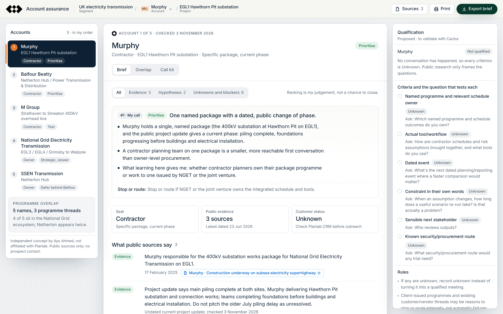

# Account assurance: UK electricity transmission

**Independent concept by Ayo Ahmed, not affiliated with Planlab.**

1. I picked one segment, UK electricity transmission, and checked public, dated sources on five accounts: two owners and three contractors.
2. The workspace separates what the sources say from what I'd test, what is unknown and what could block a conversation. It also shows that the five names share programmes, so they are not five independent opportunities.
3. I worked one account (National Grid Electricity Transmission) through to a role-play call, discovery questions and objections. No prospect has been contacted, and nothing here reports a result.



## What is in the workspace

| View | What it shows |
|---|---|
| **Accounts rail** | The five accounts in my order, with seat (owner or contractor) and my call (Prioritise, Test, Strategic, Defer) |
| **Brief** | My call and why; evidence with dates and source links; the hypothesis and opening question to test; unknowns and possible blockers; the overlap warning. Filter by Evidence, Hypotheses, or Unknowns and blockers. |
| **Overlap** | Accounts by programme thread, why I'd test contractor-side first, and what would make me stop or route each account |
| **Call kit** | The worked NGET call: why this account, product fit in Planlab's own public words, a 30-second opening, discovery, objections, a follow-up (not sent) and a proposed first-week experiment |
| **Qualification pane** | Six criteria, all Unknown until a real conversation happens, each with the question that tests it, plus practice notes that stay in your browser |
| **Sources drawer, Print, Export** | Every source with date and URL; a print layout with full URLs; a Markdown export of one account or all five |

## Ground rules I held myself to

- Every evidence claim links to a public source with its date. All were checked on 3 November 2026.
- Hypotheses, unknowns and blockers are labelled as such and kept apart from evidence.
- People named in public sources are labelled as sponsors, not verified purchasing owners. Buyer roles are unverified.
- Customer and CRM status is unknown for all five accounts and must be checked internally before any approach.
- There are no claims about any team's pain, tools or needs; those are for discovery.
- There is no AI chat, simulated analysis, invented pipeline, reply, meeting or revenue figure, and no personal contact details.

## Run it

You need Node 20 or later. There are no runtime dependencies.

```bash
npm run preview
```

That builds `dist/` and serves it at http://127.0.0.1:4173/. Deep links work, for example `#/nget/call` or `#/ssen/brief?filter=unknown`.

```bash
npm test
```

That runs 8 data-integrity tests and 17 browser tests in headless Chromium (needs Playwright with Chromium: `npx playwright install chromium`). Results are in [docs/TEST-RESULTS.md](docs/TEST-RESULTS.md).

```bash
npm run check:links
```

That checks every cited URL from your own network.

## Deploy (free, static)

`npm run build` writes a self-contained static site to `dist/`. It needs no server code, database, API keys or secrets.

- **Cloudflare Pages:** run `npx wrangler pages deploy dist --project-name planlab-account-assurance` after `npx wrangler login`. Or create a Pages project in the dashboard and upload `dist/`. `dist/_headers` sets a strict content security policy and `noindex`.
- **GitHub Pages (fallback):** publish the contents of `dist/`.

## Repository map

```
site/            workspace source (HTML, CSS, ES modules, data)
  data/          accounts.js and callkit.js (from research/), judgement.js (my order and reasoning)
research/        the verified account research and call kit, as supplied
assets/          design tokens and the Planlab logo (reference)
docs/            brand guide, style guide, PRD, decisions, memo, tests, roadmap, screenshots
scripts/         build, local server, link check, screenshots
tests/           data-integrity and browser tests
```

## Documents

- [ELI5 and three-line explanation](docs/ELI5.md)
- [Product requirements](docs/PRD.md)
- [Jobs to be done and five whys](docs/JTBD-5-WHYS.md)
- [Viability memo: why this fits the Founding SDR job](docs/VIABILITY.md)
- [Decisions](docs/DECISIONS.md)
- [Test results](docs/TEST-RESULTS.md)
- [Roadmap](docs/ROADMAP.md)
- [Brand reference](docs/BRAND.md) and [style guide](docs/STYLE-GUIDE.md)

## Brand and licences

The workspace borrows Planlab's public product idiom for a candidate exercise. The Planlab name and logo belong to Planlab. The HafferXH typeface is commercially licensed, so it is not included. The workspace uses HafferXH only where it is installed locally, and otherwise falls back to the bundled Inter (SIL Open Font License, `site/fonts/OFL-Inter.txt`). Brand provenance and verification limits are in [docs/BRAND.md](docs/BRAND.md).
