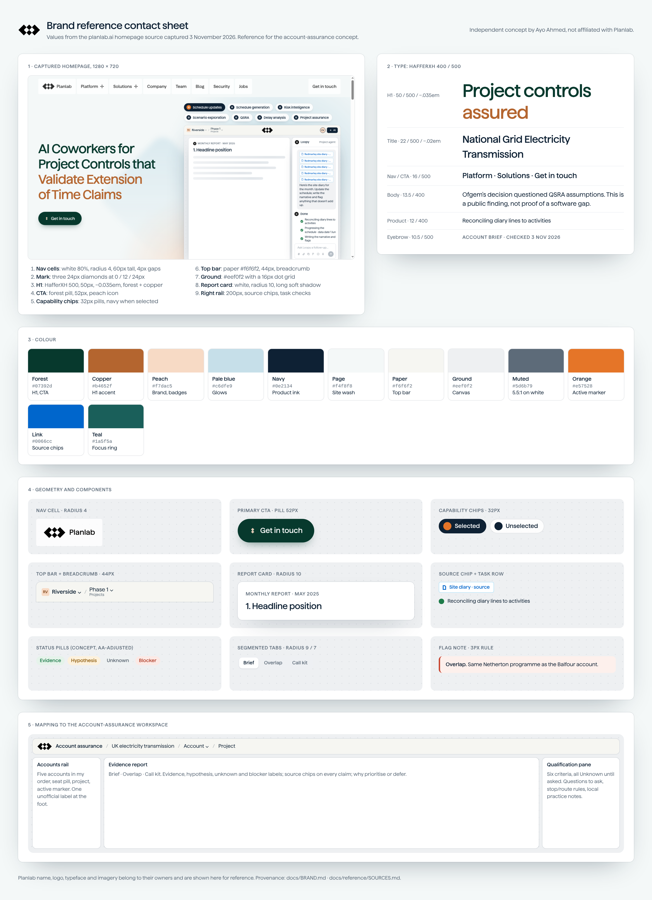

# Style guide: account assurance workspace

This guide shows how the captured Planlab brand ([BRAND.md](BRAND.md)) maps onto this concept. All tokens live in [`assets/tokens/tokens.css`](../assets/tokens/tokens.css), with a machine-readable copy in `tokens.json`.

## Principles

1. **The product, not the marketing page.** The concept borrows the app-stage shell (paper top bar, breadcrumb, dotted ground, white report card, narrow right pane). There is no hero, glow or headline-led landing page.
2. **Calm and dense.** Small type (12–14px body), hairline rings and generous inner padding. Colour is reserved for state.
3. **The label carries the meaning.** Every status pill carries a word (Evidence, Hypothesis, Unknown, Blocker), never colour alone.
4. **Nothing pretends.** No agent, chat input, AI button, typing cursor, spinner, shimmer or "thinking" state, and no number that suggests a probability.

## Layout

| Zone | Desktop (≥ 1180px) | Tablet (760–1179px) | Phone (< 760px) |
|---|---|---|---|
| Top bar | 52px paper bar: logo, then "Account assurance", then the Segment / Account / Project breadcrumb; Sources and Export actions at right | Same, breadcrumb truncates | Logo and account crumb only; actions become icon buttons with labels |
| Accounts rail | 264px left column, white panel on the ground | 232px | Horizontal, scrollable row of account cards above the report |
| Report centre | Fluid; white card, radius 10, `--sh-card`; max width 860px | Fluid | Full width, 12px margin |
| Qualification pane | 300px right column (agent-rail geometry) | Below the report, full width | Below the report |
| Canvas | `--pl-ground` with a 1px `#0e213412` dot on a 16px grid | same | same |

The page never scrolls horizontally at 320, 390 or 1440px. Wide tables and the overlap matrix scroll inside their own container.

## Type ramp (HafferXH, then Inter, then system-ui)

| Token | Size / weight / tracking | Use |
|---|---|---|
| Title | 22px / 500 / −0.02em | Account name in the report card |
| Section | 15px / 500 / −0.01em | Report section headings |
| Panel | 13px / 500 | Rail and pane headings, buttons |
| Body | 13.5px / 400 / lh 1.55 | Evidence and hypothesis prose |
| Small | 12px / 400 | Meta text, dates, crumbs |
| Eyebrow | 10.5px / 500 / uppercase / +0.06em | "Account brief · checked 3 Nov 2026" |
| Pill | 10.5px / 500 | Status pills |

The product mock's 12px body is too small for long evidence prose, so the concept raises reading text to 13.5px and keeps the mock's sizes for chrome.

## Colour roles

| Role | Token | Notes |
|---|---|---|
| Text | `--pl-navy` #0e2134 | 16.3:1 on white |
| Secondary text | `--pl-muted` #5d6b79 | 5.5:1 on white |
| Top bar | `--pl-paper` #f6f6f2 | |
| Canvas | `--pl-ground` #eef0f2 + dots | |
| Lines | `--pl-line` #e3e7eb | |
| Selection / current | `--pl-navy` fill, white text | As the selected capability chip |
| Active marker | `--pl-orange` #e57528 | 3px rail indicator and the selected chip's icon; never text |
| Primary action | `--pl-forest` #07392d pill | One primary action per view at most (Export) |
| Links / sources | `--pl-link` #0066cc on white | Source chips |
| Focus | 2px `--pl-teal` #1a5f5a outline, 2px offset | |

## Evidence semantics

| Label | Meaning | Text | Background |
|---|---|---|---|
| **Evidence** | Public, dated, linked source states it | #1e7b4a | #e5f3ea |
| **Hypothesis** | My inference to test in conversation | #8f5d0e | #fdf1dc |
| **Unknown** | Not established publicly; must be asked or checked internally | #5a6571 | #eef1f2 |
| **Blocker** | A reason the account could stall or be the wrong route | #b0402c | #fce9e5 |

The captured amber, red and grey were darkened to pass WCAG AA at pill size; the backgrounds are as captured. Sponsor names are always followed by "sponsor, not verified purchasing owner".

## Components

- **Account row (rail).** 12px padding, radius 8. Shows name (13px/500), seat pill (Owner or Contractor) and project (12px muted). When current, the row is navy-filled with white text and has a 3px orange left marker. Rows are buttons with `aria-current`, and arrow keys move between them.
- **Breadcrumb.** Segment / Account ⌄ / Project, with the workspace badge (peach, `#7a3f12`, radius 3px) showing the account's initials. The Account crumb is a working menu button that switches account.
- **Segmented tabs.** `--pl-tabs` track, radius 9px; the current tab is white with `--sh-tab`. Used for the views (Brief, Overlap, Call kit) and the evidence filter (All, Evidence, Hypothesis, Unknowns). These follow the ARIA tabs and radio patterns.
- **Source chip.** Link blue, `#0ea5e94d` border, radius 4px, document icon plus publisher and date. It opens the source in a new tab, and the Sources drawer lists every source.
- **Note (flag).** 3px left rule with a radius-8 tinted panel, used for the overlap or concentration warning on every account.
- **Drawer.** Right sheet, 420px (full width on phone), white, `--sh-frame`. Esc closes it and focus returns to the opener.
- **Qualification row.** Mirrors the mock's task row. Every criterion starts as Unknown, with the question to ask beneath. No green ticks, because nothing has been qualified.
- **Practice notes.** A textarea labelled "Practice notes: stored only in this browser". It is clearly hypothetical and uses local storage only.

## Print and export

- **Print.** Prints the current account brief (and the call kit if open) on white, without the rail or top-bar controls. Source URLs are printed in full.
- **Export.** Downloads a Markdown brief for the current account, with every claim followed by its source URL and date.

## Labelling

There is one discreet line, at the foot of the accounts rail (and in print footers): "Independent concept by Ayo Ahmed, not affiliated with Planlab." Source-capture provenance stays in these docs, not in the app.

## Reference

